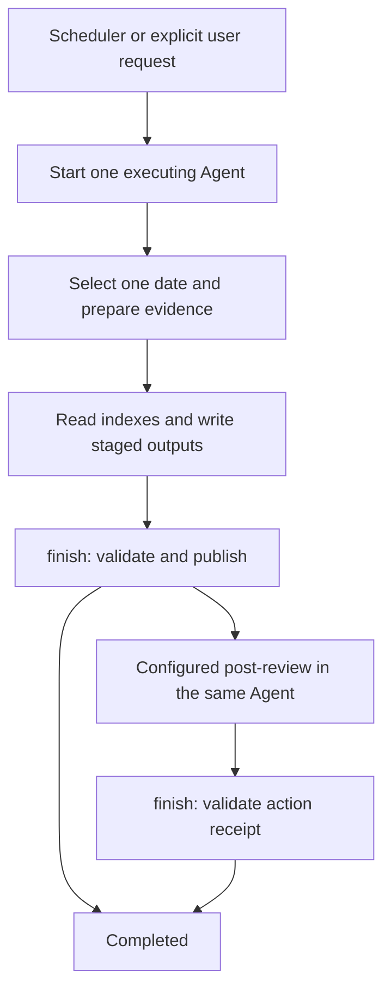

# Technical architecture and decisions

English | [简体中文](zh-CN/ARCHITECTURE.md)

This is the technical overview for the [PRD](REQUIREMENTS.md).
It summarizes the current design and its limits before linking to detailed
contracts. It does not authorize new product behavior. Changes follow
[Contributing](../CONTRIBUTING.md), including technical changes that leave
the product's visible purpose unchanged.

## T1. Responsibilities and implementation choices

My Big Brother is a local repository. Small Python modules prepare evidence,
validate artifacts and publish files. Shared Markdown tasks guide the Agent's
interpretation. The core uses the standard library. Screenshot processing
optionally uses Pillow. There is no service or generic plugin framework.

| Boundary | Responsibility | Important separation |
| --- | --- | --- |
| Collector | Record activity in its host application | No review boundary, model invocation or report generation |
| Source adapter | Read selected records and produce factual indexes/assets | No semantic report generation or execution of logged commands |
| Analysis task | Guide evidence reading, task attribution and outputs | No dependence on one harness's process API |
| Common runtime | Paths, preparation, validation, publication and dated status | No Agent launches or hidden semantic orchestration |
| Startup adapter | Launch one Agent with execution settings and logs | No business planning, input import, publication or model retry loop |
| Personal profile | Bind references, formats, destinations and follow-up operations | No hardcoded personal dependency in the standard product |

Native log readers and startup adapters are independent. Reading Codex logs
does not select Codex as the executor. The bundled startup adapter is Codex,
but other Agents use the same commands and task contracts. A native scheduler
can invoke its Agent without a project-specific launcher.

This design implements PRD P1–P5 and P9: reuse one analysis across outputs,
keep installations portable, and isolate application/harness integrations.
It favors explicit adapters and configured profiles over an automatic plugin
loader or a program that runs a new model for each analysis phase.

## T2. Invocation and run lifecycle

The scheduler is external. The startup adapter starts exactly one Agent.
All date planning, preparation, interpretation, publication and completion
checks happen through commands called by that executing Agent.
The Agent may delegate through its own supported facilities.



1. Without an explicit date, `begin-automation`, `plan-due` and `due` select
   only the latest closed logical day. A retained completed date is skipped.
   There is no historical catch-up queue.
2. For a new review, `prepare` or `analyze` creates an isolated run, source
   manifest, indexes, excerpts, optional assets and resolved `context.json`.
   `due` or `analyze` resumes retained pending actions without regenerating
   already published reports.
3. Existing selected formal outputs are copied into staging for merging.
   The Agent follows the shared task and explicit personal instructions.
4. `finish` validates identities, entry coverage, output structure and selected
   validators, then publishes. Blocked required sources cannot complete.
5. Configured follow-up returns `actions-pending`. The same Agent performs it
   in the declared scope and submits its action receipt for a later `finish`.
6. A launcher context adds invocation-level ticket/receipt checks.
   `agent-exited` reports process termination, not completed review.

An empty evidence run can return `empty` without claiming analysis completion.
An explicitly requested `--allow-empty` can permit a review using retained
outputs and declared references. This does not waive required-source checks.
See [AUTOMATION.md](../tasks/daily-review/AUTOMATION.md),
[WORKFLOW.md](../tasks/daily-review/WORKFLOW.md) and
[Scheduling](SCHEDULING.md) for the exact command sequence.

## T3. Paths, time and data lifetimes

The checkout is separate from platform configuration directory C and data
base D. Missing configuration is different from an absent optional locator:
`config.json` supplies review settings, while `raw-logs-path.txt` contains
only one absolute capture-root path. With no explicit override or TXT,
applications use platform defaults. Vim's explicit `record_dir` takes priority
over the TXT. No application depends on `storage.json` or a registry.

```text
C/
  config.json
  raw-logs-path.txt                   optional shared locator
  profile.json, local-tasks/          when explicitly selected
D/
  raw-logs/                          default disposable root
    .publish.lock                    one fixed-size global lock
    YYYY-MM-DD/
      bash/ vim/ screenshots/
      .review.lock
      review.json
      _analysis/RUN/
        context.json, manifest.json
        publication.json
        indexes/ excerpts/ drafts/ logs/ actions/
      _launches/INVOCATION/
  memory/                            default results_root
    USER-MODEL.md, MACHINE-CONTEXT.md  when selected
    records/YYYY-MM-DD/
```

`results_root` and profile bindings can select permanent destinations outside
D/memory. Those are output locations, not another permanent runtime-state area.
All date-specific completion, publication and action state stays with the
raw-log date. Removing an inactive date abandons its recovery. There is no
permanent identity file, deleted-date tombstone or per-day operation ledger.
The one global publication lock contains no history and does not grow by date.

Collection uses real local natural dates. Bash/Vim freeze their location at
session start. Screenshots use each capture's date. Analysis separately applies
`day_start_hour` and an inclusive-start, exclusive-end window.
Bash/Vim readers search all retained start dates, then filter event times or
session overlap. Screenshot readers visit the capture dates in the window.
A final whole-session Vim diff cannot precisely locate edits within that window.

This separation implements PRD P4, P6 and P8 without putting review calendars
or application initialization into independent recorders.
Exact defaults, locator validation, filenames and lifecycle are in
[Storage](STORAGE.md), [Input sources](INPUT-SOURCES.md),
[Bash](BASH.md) and [Vim](VIM.md).

## T4. Concurrency, conflicts and recovery

| Concern | Current strategy | Limit or failure behavior |
| --- | --- | --- |
| Concurrent work for one date | Nonblocking dated `.review.lock` during common commands | A competing command fails, rather than silently running concurrently |
| Different dates updating shared outputs | Fixed-size `raw-logs/.publish.lock` serializes publication and completion updates | It is not a promise to serialize arbitrary external writers or an entire model session |
| Changes after preparation | Record original output hashes and check the complete publication set before replacement | Preserve conflicting human/newer changes and stop publication |
| Partial publication | Atomic replacement per file, with `publication.json` in that run | No all-files transaction or automatic rollback guarantee |
| Retry of retained work | Check the journal, stable identities, current targets and receipts | Changed drafts/configuration or invalid receipts require diagnosis or a new run |
| Follow-up operations | Task-owned idempotence, validator and action-local journal/receipt | Core phase completion is not a generic transaction engine for arbitrary effects |
| Manual date deletion | Completion and recovery records are deleted with the date | No automatic recovery of deleted history. Explicit reruns verify existing external effects |

Publication's temporary payload remains in the dated run. Formal outputs and
raw logs must therefore share a filesystem in the current implementation.
Cross-filesystem publication stops before replacing outputs. This is a known
implementation limit, not a requirement to use this author's paths.

Changes to lock strategy, atomicity, conflict handling or recovery guarantees
are technical contract changes, even if the visible report names stay the same.
Exact publication and profile constraints are in [Storage](STORAGE.md) and
[Profiles](PROFILES.md). User cleanup behavior is in [Cleanup](CLEANUP.md).

## T5. Task contracts, profiles and extension seams

Adapters retain source-specific facts and explicit gaps. The common preparer
assigns evidence identities and separates compact indexes from readable excerpts.
The task reads the complete prepared index and maintains one coherent timeline
and task map. Structural receipt checks do not verify semantic correctness.

The task's standard output schema is independent of a private user's existing
schema. A selected profile can override bindings and declare a custom schema
with its validator. References are read on demand. User-authorized read scope
can span the machine and is independent of the launch directory. Write targets
remain explicitly selected for staging/publication and follow-up.
Historical evidence never grants permissions or overrides trusted instructions.

| Detailed contract | What it owns |
| --- | --- |
| [Input sources](INPUT-SOURCES.md), [Bash](BASH.md), [Vim](VIM.md) | Formats, timestamp/cwd semantics, supported variants and coverage limits |
| [Output contracts](../tasks/daily-review/OUTPUTS.md), [Knowledge task](../tasks/daily-review/KNOWLEDGE.md) | Standard report content, schemas and cumulative knowledge merge rules |
| [Profiles](PROFILES.md) | Personal instruction/reference bindings, custom validators and action scope |
| [Scheduling](SCHEDULING.md), [AUTOMATION.md](../tasks/daily-review/AUTOMATION.md) | Startup environment, one-Agent execution and command/receipt sequence |
| [Extending](EXTENDING.md) | Interfaces for adding a collector, reader, task, output or startup adapter |

Update the owner of a detail, plus the PRD/overview summary when affected.
Do not create a competing full specification in an implementation report.
Long technical alternatives can have a separate proposal when needed, but the
resulting current choice and its tradeoff must still be summarized here.

## T6. Code map and verification limits

```text
my_big_brother/
  sources/          native/collected source adapters
  analyzers/        Agent-specific startup boundary
  collector_paths.py, paths.py, config.py
                    platform discovery, locator and review configuration
  storage.py        disposable date helpers and file locking
  runner.py         evidence preparation, validation and publication
  automation.py     invocation planning/verification called by the Agent
tasks/daily-review/ shared English task contracts
collectors/bash/    standalone optional Bash recorder
docs/              public product/technical/user documentation
examples/          synthetic outputs and scheduling templates
```

The test suite uses isolated inputs and temporary destinations. Tests cover
mechanisms such as history preservation, dates, coverage, conflicts and retries.
Real Agent interpretation, native platform execution and actual timer firing
are separate verification levels. Linux fixture success does not establish
native macOS/Windows correctness. See [Contributing](../CONTRIBUTING.md) for
the development baseline and required change/validation record.
